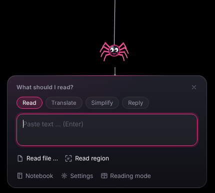
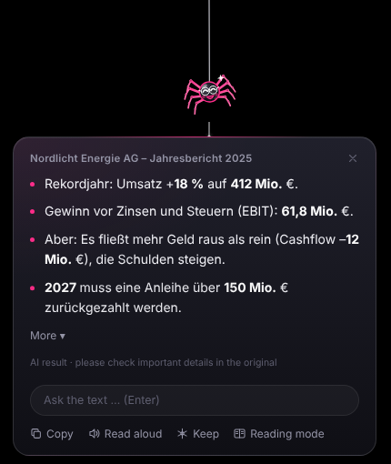
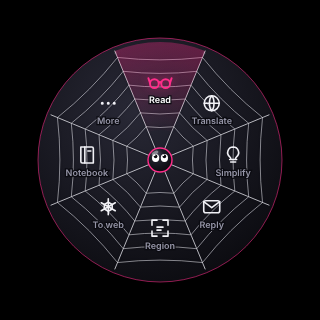

<p align="center"></p>

# 🕷 Silkreader

**English** · [Deutsch](README.de.md)

A small spider hangs at the top of your screen. Select some text, click the spider, and it reads it for you – either free and offline on your PC, or with Claude. A big spider crawls over the selected words, then the result pops up in a speech bubble.

<p align="center"></p>

## What it does

- **The essentials** in plain bullet points – plus key points, insights and figures, each with the source passage
- **Ask the text** a question, **translate**, **plain language**, **reply drafts** for e-mails, **read aloud**
- Keep files in the **spider web**, a **notebook** of your last 20 texts, **deadlines** straight into your calendar
- Read any **screen region** with Windows' built-in text recognition

<p align="center">
  
  
  
</p>

## Install (Windows 10/11)

1. Download the latest `Silkreader-Setup-….exe` from [Releases](https://github.com/Sebbilore/silkreader/releases/latest).
2. Run it. If Windows shows “Windows protected your PC”, click **More info → Run anyway** (the app is not yet signed with a purchased certificate).
3. The spider appears at the top of your screen and a short **setup** explains everything: how to use it, which AI to use, and what happens to your data.

Updates install automatically – only if they are signed with the Silkreader certificate.

## How to use it

| | |
|---|---|
| **Select text, click the spider** | The big spider reads along, the result appears in a speech bubble |
| **Click the spider with nothing selected** | Mini bubble: paste text, read the clipboard or a file, recent texts |
| **Right-click the spider** or **Ctrl+Alt+Space** | The spider-web ring with every action – tap, or hold, point and release |
| **Mouse wheel on the spider** | Choose what a click does: read, translate, simplify, reply |
| **Drag files onto the spider** | They stick in its web; click a cocoon to read it |
| **Click an item in the result** | A magnifier shows the source passage; “Show on screen” sends the big spider there |

Tip for Logitech mice (e.g. MX Master): map a button or an Actions Ring slot to *Ctrl+Alt+Space* in Logi Options+.

Shortcuts (all configurable in the settings): **Ctrl+Alt+S/A** read · **T** translate · **L** plain language · **R** reply · **B** screen region · **N** notebook · **K** pin to web · **H** hide spider.

## Built-in AI or Claude?

| | **Built-in** (default) | **Claude** |
|---|---|---|
| Cost | free | a few cents per text (your own API key) |
| Internet | only once, to download the model (1 GB) | required |
| Privacy | everything stays on your PC | texts are sent to Anthropic |
| Quality | good; reads long documents section by section | best |

Pros can also use their own model via [Ollama](https://ollama.com).

## Privacy

No servers of its own, no account, no ads, no tracking. Details: [src/privacy.html](src/privacy.html) (also in the app under *About Silkreader*). Clipboard features are off until you turn them on.

AI can make mistakes – always check important details (contracts, deadlines, figures) in the original.

## Development

```bash
npm install
npm start            # run the app
npm run dist:win     # build the Windows installer
npm run dist:store   # Microsoft Store package (see electron-builder.store.js)
npm run notices      # regenerate third-party licenses
```

Tests: `test/*.mjs` (Linux, virtual display, mock AI) and `test/windows.mjs`, which runs on a real Windows machine on every change and before every release – real Notepad, real shortcuts and mouse clicks, OCR and the update signature check.

The code and comments are in German. See [CHANGELOG.md](CHANGELOG.md), [SECURITY.md](SECURITY.md) and [LICENSE](LICENSE) (MIT).
