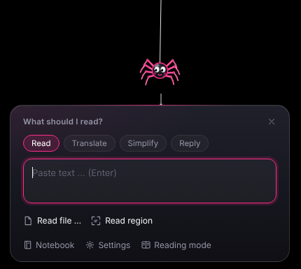
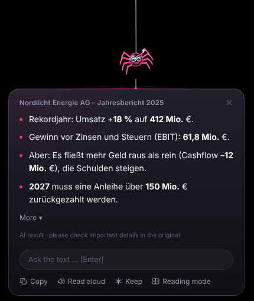
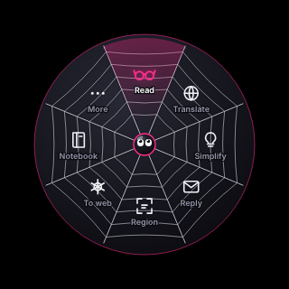
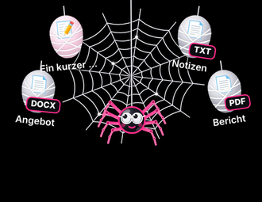
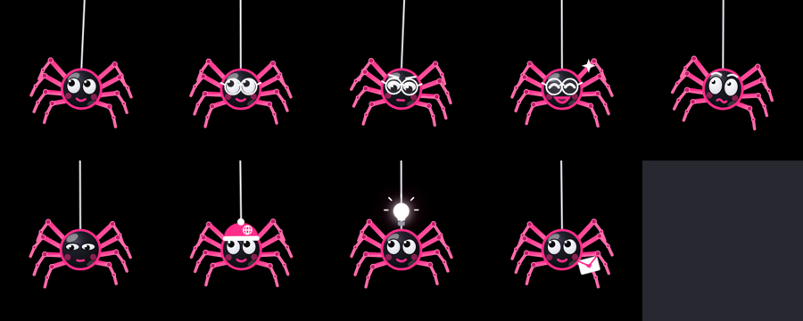
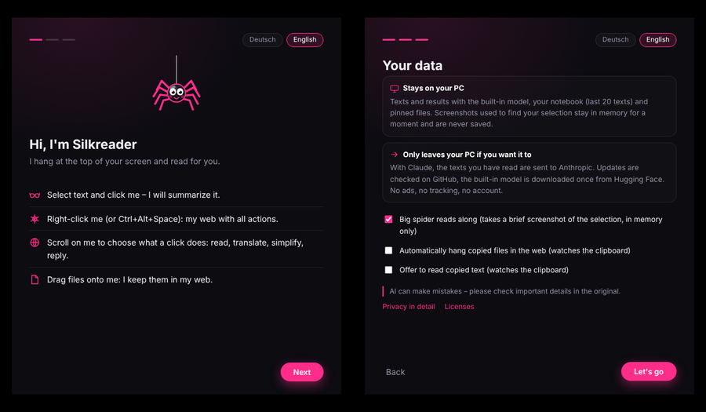
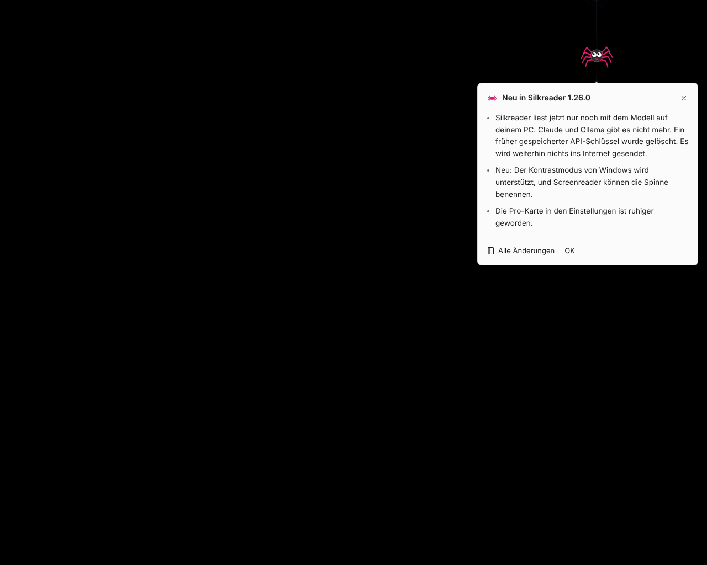

# Vorher/Nachher-Bilder

Fortlaufend pro Version: neue Version = neuer Abschnitt oben, Bilder in `store/bilder/<Version>/`. „Vorher“ ist immer der Stand der vorigen Version, „Nachher“ der neue. Ideen und Begründungen: `docs/ideen.md`. Store-Unterlagen: `store/STORE.md`.

## 1.26.0 (in Vorbereitung)

Vorher = Stand 1.25 (`bilder/1.25/`), Nachher = Stand 1.26.0 (`bilder/1.26.0/`). Gleiche Dateinamen, damit sie sich leicht vergleichen lassen.

| Bild | Vorher (1.25) | Nachher (1.26.0) |
|---|---|---|
| Sprechblase |  |  |
| Ergebnis |  |  |
| Spinnennetz-Ring |  |  |
| Kokons |  |  |
| Stimmungen der Spinne |  |  |
| Icon |  |  |
| Willkommen |  |  |

Nur neu in 1.26.0 (kein Vorher-Bild vorhanden: **fehlt**):

- „Was ist neu?“-Sprechblase: 
- Hinweis zur Umstellung auf das eingebaute Modell: 
- Einstellungen mit ruhigerer Pro-Karte (Vorher-Bild der alten Pro-Karte **fehlt**): 

Hinweis: Die Bilder in `bilder/1.25/` stammen aus `docs/images/` im Repo, die in `bilder/1.26.0/` aus dem Projektordner `release-1.26.0/design/images/`. Ob sich 1.25 und 1.26.0 bei jedem Bild sichtbar unterscheiden, wurde nicht einzeln geprüft (die Dateien sind nicht identisch).
