# Vorher/Nachher-Bilder

Fortlaufend pro Version: neue Version = neuer Abschnitt oben, Bilder in `store/bilder/<Version>/`. „Vorher“ ist immer der Stand der vorigen Version, „Nachher“ der neue. Ideen und Begründungen: `docs/ideen.md`. Store-Unterlagen: `store/STORE.md`.

## 1.29.0 (Entwurf, nicht veröffentlicht)

Bilder in `bilder/1.29.0/`. Vorher = Stand 1.28.0, Nachher = main.

| Bild | Vorher | Nachher |
|---|---|---|
| Kombi-Modus: Einstellungen (neue Wahl „Kombi“) | – (neu) | 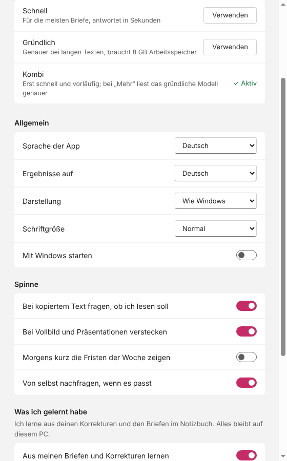 |
| Kombi-Modus: Ergebnis (Hinweis „vorläufig“ unten) | – (neu) | 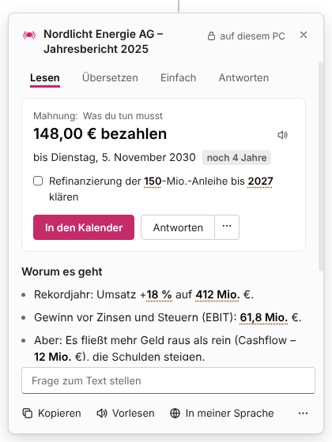 |
| Kombi-Modus: „Ich lese genauer, das dauert einen Moment.“ | – (neu) | 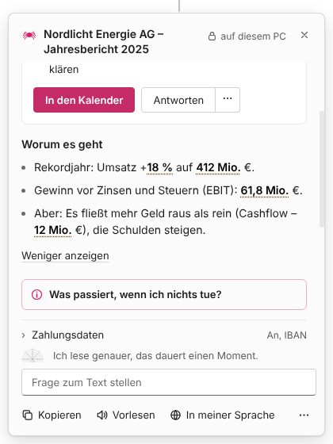 |
| Neue Nachfrage bei Terminen und Fristen („Soll ich mir das merken? Zahnarzt-Termin, 12.11.“, Ja oder Nein, nichts wird ohne Ja gespeichert) | – (neu) |  |
| Einstellungen: Morgenmeldung jetzt standardmäßig an, Hinweis zu Outlook (klassisch, nur die geöffnete Mail) | – (neu) | 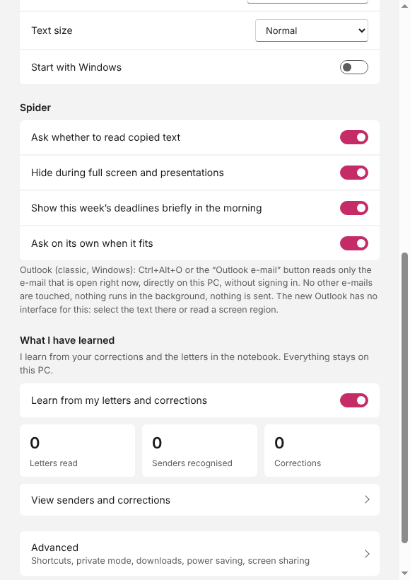 |
| Vorlesen-Leiste (Satz zurück/vor, „Original vorlesen“ liest den ganzen Brief mit Zeilenumbrüchen) | 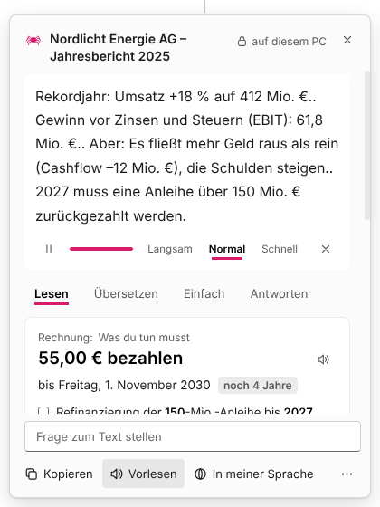 | 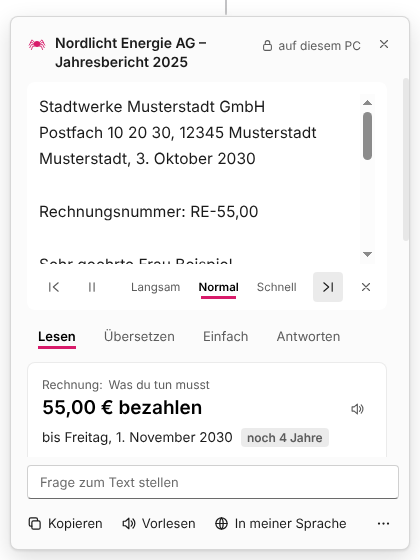 |
| Nachfrage „Soll ich mir das merken?“ aufgeräumt (kleinere Karte, Buttons nebeneinander, nichts mehr abgeschnitten) | 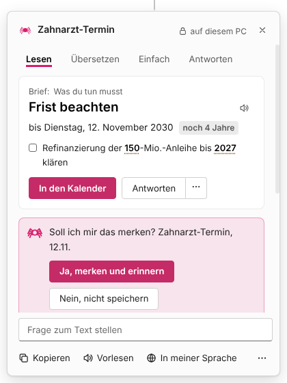 | 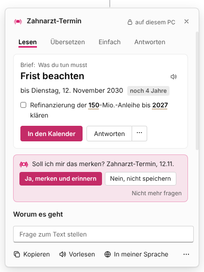 |

## 1.27.0 (Release läuft)

Bilder in `bilder/1.27.0/`. Vorher = Stand 1.26.0 (Auswahl fehlte oben), Nachher = 1.27.0.

| Bild | Vorher | Nachher |
|---|---|---|
| Auswahl nach dem Lesen | 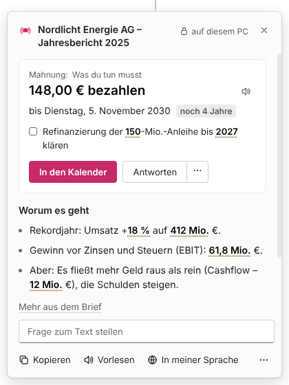 |  |

Nur neu: „Was ist neu?“ für 1.27.0 (die klügere Datum-Analyse ist unsichtbar, daher kein Bildvergleich): 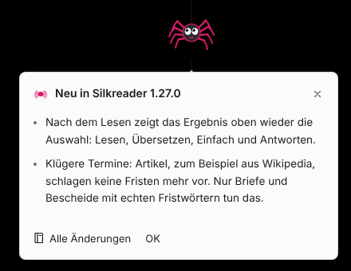

## 1.26.0

Vorher = Stand 1.25, Nachher = Stand 1.26.0, beides in `bilder/1.26.0/` (Namen `…-vorher.png` und `…-nachher.png`). Der Ausgangsstand 1.25 liegt zusätzlich in `bilder/1.25/`. Gleiche Bilder liegen im Projektordner `Silkreader-Bilder/` (siehe `bilder/index.md`).

| Bild | Vorher (1.25) | Nachher (1.26.0) |
|---|---|---|
| Sprechblase | 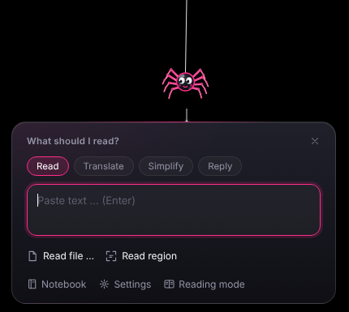 |  |
| Ergebnis | 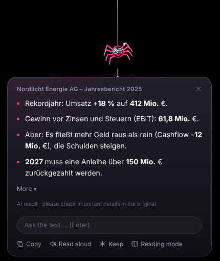 |  |
| Spinnennetz-Ring | 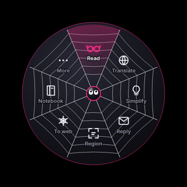 |  |
| Kokons |  |  |
| Stimmungen der Spinne |  |  |
| Icon |  |  |
| Willkommen |  |  |
| Auswahl nach dem Lesen (Lesen, Übersetzen, Einfach, Antworten oben im Ergebnis) |  |  |

Nur neu in 1.26.0 (kein Vorher-Bild vorhanden: **fehlt**):

- „Was ist neu?“-Sprechblase: 
- Hinweis zur Umstellung auf das eingebaute Modell: 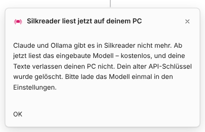
- Einstellungen mit ruhigerer Pro-Karte (Vorher-Bild der alten Pro-Karte **fehlt**): 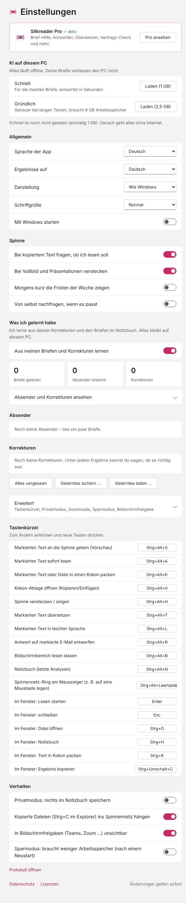

Hinweis: Die Bilder „vorher“ und `bilder/1.25/` stammen aus `docs/images/` im Repo, die „nachher“-Bilder aus dem Projektordner `release-1.26.0/design/images/`. Ob sich 1.25 und 1.26.0 bei jedem Bild sichtbar unterscheiden, wurde nicht einzeln geprüft (die Dateien sind nicht identisch).
